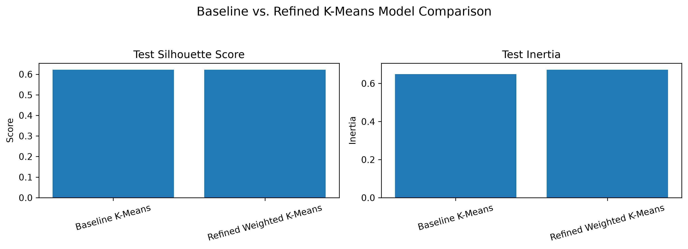
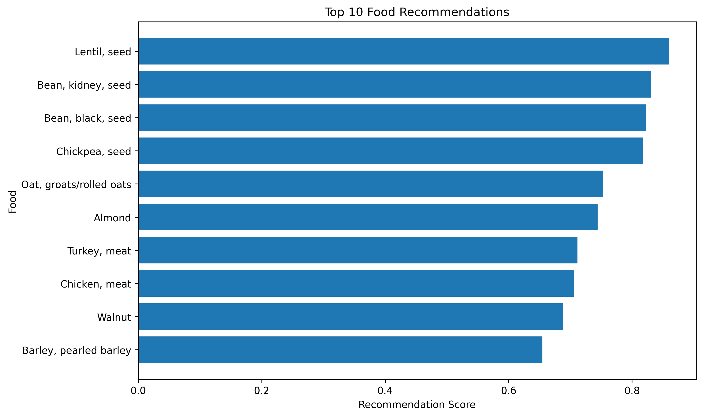

Smart Sustainable Meal Optimizer

This project explores how meal recommendations can balance nutrition, cost and environmental impact. The goal is to develop a data-driven tool that helps users find food combinations that meet nutritional needs while staying within a budget and reducing environmental impact.

Problem Statement

Choosing meals involves balancing nutritional goals, affordability and environmental sustainability. Foods that provide protein and calories may differ in price and greenhouse gas emissions. This project uses data analysis and machine learning to explore these tradeoffs and support more informed food choices.

The intended outcome is a meal recommendation tool that can eventually help users identify combinations that fit their nutritional needs and budget while considering environmental impact.

Data

The project combines information from the following sources:

[USDA FoodData Central](https://fdc.nal.usda.gov/): nutrition information, including protein, fat, carbohydrates and calories.

https://css.umich.edu/page/datafield : estimated greenhouse gas emissions associated with food.

USDA Economic Research Service sources: food price information.

The combined dataset contains 52 foods. Four foods have missing comparable price data, leaving 48 foods for the current modeling evaluation.

Data preparation included combining nutrition, price and environmental information, checking missing values and selecting comparable foods for modeling. Environmental impacts and prices are estimates or averages and may not represent every product or location.

Methodology

Weighted Food Recommendations

A weighted scoring approach ranks foods using four factors:

Protein score: 40%

Calorie score: 20%

Cost score: 20%

Environmental score: 20%

The nutrition features are scaled so they can be combined. Price and environmental scores are reversed so lower cost and lower estimated emissions receive higher scores.

K-Means Clustering

K-Means is a useful starting point for this prototype because it groups foods with similar numerical characteristics without requiring pre-existing food-category labels. The four features—protein, calories, price per 100 g and estimated CO2-equivalent emissions—represent the project's main nutrition, affordability and environmental considerations. Scaling the features before clustering is important because they use different units and ranges. Otherwise, a feature with larger numerical values could dominate the distance calculations.

Earlier experiments compared 2, 3, 4 and 5 clusters. Three clusters were used for the Unit 7 comparison so the refined model could be compared with the existing baseline using the same setup.

The refined model multiplies the scaled protein feature by 1.5 and the scaled environmental-impact feature by 1.2, while leaving calories and price at 1.0. This weighting tests the project assumption that protein and environmental impact should have somewhat greater influence. These values are design choices for experimentation, not weights proven to be optimal. Both models use the same 80/20 train/test split and random seed so the comparison is consistent.

Results

Model Comparison

The baseline and refined models produced the following test results:

Model

Test Silhouette Score

Test Inertia

Baseline K-Means

0.622

0.649

Refined Weighted K-Means

0.622

0.672

The silhouette score was the same for both models, so the feature weighting did not improve measured cluster separation on this test split. The baseline also had lower test inertia. Based on these metrics, the refined model did not outperform the baseline. These are clustering-quality measures, not prediction accuracy, and the small test set means the results should be treated as an initial comparison rather than a final conclusion.

Food Recommendations

The weighted scoring model ranks foods by the balance of protein, calories, affordability and estimated environmental impact.

The rankings reflect the chosen weights and available data. A lower recommendation score does not necessarily mean a food is unhealthy or unsuitable for every meal.

Limitations and Future Work

The current dataset is small and contains only 48 foods with comparable price data. Food prices vary by location, store and time, while environmental impacts are estimates that may not reflect individual products.

The current scoring model ranks individual foods rather than verifying whether complete meals meet a person's specific nutritional requirements. Clustering also groups similar foods but does not directly optimize meals.

Future work will focus on expanding the dataset, testing additional model configurations, improving visualizations and developing meal-level recommendations that account for nutritional targets, budget limits and environmental impact.

Setup

Clone or download this repository and open the project folder in a terminal.

Create and activate a Python virtual environment if desired.

Install the required Python packages:

pip install -r requirements.txt

Open notebooks/01_data_exploration.ipynb in Jupyter Notebook or VS Code.

Run the notebook cells in order from the project notebook. The notebook uses relative paths to access files in data/processed and to save charts in images, so keep the repository folder structure intact.

The current workflow depends on the source and processed data files included in the repository. If you move the notebook outside the project structure, update its relative paths before running it.

Technologies Used

Python

pandas and NumPy

scikit-learn

Matplotlib

Jupyter Notebook

